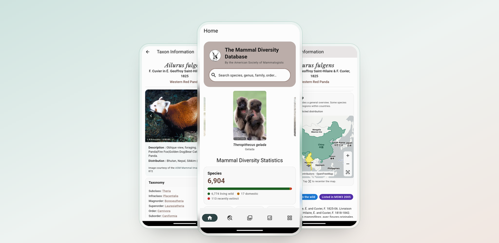

# mdd_app




A cross-platform application to compliment the Mammal Diversity Database. It features offline access, advance search with data filtering, and support to export a subset of the data to a Comma-Separated Values (CSV) or JSON file.

## What's new

- Fix a blank screen on launch on iOS 27.
- Refresh the offline database after each app update.
- Page statistic tables and clean the layouts.

## Installation

<a href="https://apple.co/4vlBaxa"></a>&nbsp;&nbsp;&nbsp;
<a href="https://play.google.com/store/apps/details?id=com.hhandika.mdd"></a>&nbsp;&nbsp;&nbsp;
<a href="https://apps.microsoft.com/detail/9p2nmslctglg"></a>&nbsp;&nbsp;&nbsp;
<a href="https://snapcraft.io/mammal-diversity"></a>

<sub><sup>Apple and the Apple logo are trademarks of Apple Inc., registered in the U.S. and other countries. App Store is a service mark of Apple Inc. Google Play and the Google Play logo are trademarks of Google LLC. Microsoft Store is a trademark of the Microsoft group of companies. Snap Store and the Snapcraft logo are trademarks of Canonical Ltd.</sup></sub>

### Android

You can download the app on [Google Play](https://play.google.com/store/apps/details?id=com.hhandika.mdd). Click the badge above or scan the QR code.


### Apple Devices

You can download the app on the [App Store](https://apple.co/4vlBaxa). Click the badge above or scan the QR code.


### Linux

Install from the [Snap Store](https://snapcraft.io/mammal-diversity) or with `sudo snap install mammal-diversity`.

Alternatively, download the portable tarball (`mdd-Linux-x86_64.tar.gz`) from the [releases page](https://github.com/mammaldiversity/mdd_app/releases), extract it, and run the `mdd` executable directly. It is built on the latest Ubuntu LTS, so it requires a distribution with an equally recent glibc (Ubuntu 24.04 or newer at the time of writing).

### Windows

Install from the [Microsoft Store](https://apps.microsoft.com/detail/9p2nmslctglg).

Alternatively, download the `mdd-Windows-x86_64.zip` archive from the [releases page](https://github.com/mammaldiversity/mdd_app/releases), extract it, and run `mdd.exe`.

## Technologies

We develop the app using cross-platform, widely use technologies for mobile app development. The core technologies are:

- [Rust](https://www.rust-lang.org/): Mainly used for MDD data parsing and whenever high-performance computation is needed.
- [Flutter](https://flutter.dev/): Used for the app's user interface and to interact with the MDD data.
- [Fluter Rust Bridge](https://cjycode.com/flutter_rust_bridge/): Core package to simplify the communication between Rust and Flutter.
- [SQLite](https://www.sqlite.org/index.html): Used to store the MDD data locally and to provide offline access.

## Development

### Prerequisites

Make sure you have the following software installed. Follow the links for installation instructions.

- [Rust](https://www.rust-lang.org/tools/install)
- [Flutter](https://flutter.dev/docs/get-started/install)
- [Android Studio](https://developer.android.com/studio) or [Xcode](https://developer.apple.com/xcode/)
- An additional IDE. We recommend [Visual Studio Code](https://code.visualstudio.com/).

### Steps

- Clone the repository:

```bash
git clone https://github.com/mammaldiversity/mdd_app.git
```

0r if you are using [GitHub CLI](https://cli.github.com/):

```bash
gh repo clone mammaldiversity/mdd_app
```

- Change to the project directory:

```bash
cd mdd_app
```

- Create a `data` directory in the root of the project and place the latest `MDD.zip` and `MIL.tar.gz` inside it. This data is required to pre-generate the local SQLite database.

```bash
mkdir data
# Download MDD.zip and MIL data into the data/ directory
```

- Generate the SQLite database and run a build:

We provide convenient build scripts that build the Rust parser, generate `assets/data/mdd.db`, and compile Flutter release builds. Android is built as APKs only.

On Linux or macOS, use the bash script. It builds Android, iOS, macOS, and Linux (Linux only on a Linux host):

```bash
./tools/build.sh
```

On Windows, use the PowerShell script. It builds Android and Windows:

```powershell
.\tools\build.ps1
```

Alternatively, if you only want to generate the database manually without compiling Flutter release builds:

```bash
./tools/generate_prefilled_db.sh
```

```powershell
.\tools\generate_prefilled_db.ps1
```

The bash script downloads the latest MDD.zip and MIL release before generating. Pass `--offline` to use the newest MIL tarball already in `data/`.

To build the snap with the latest data, run `./tools/build_snap.sh`. The snap build refuses to pack a bundle whose MDD or MIL data is older than the latest upstream release.

If PowerShell blocks the scripts because of the execution policy, run them with `powershell -ExecutionPolicy Bypass -File .\tools\build.ps1`.

- Try to run the app:

```bash
flutter run
```

### Troubleshooting

#### Fix Flutter Rust Bridge

- Check if the `flutter_rust_bridge_codegen` binary installation matches the version in the `pubspec.yaml` file in the app root directory and the `Cargo.toml` file in the `rust` directory.

- If the versions do not match, reinstall the `flutter_rust_bridge_codegen` binary and update the `pubspec.yaml` and `Cargo.toml` files.

- The Rust library is compiled by the Native Assets build hook in `hook/build.dart` during `flutter build`/`flutter run`. There is no separate `rust_builder` plugin or CocoaPods step.

#### Fix Xcode build issues

- Clean flutter build cache:

```bash
flutter clean
```

- Run flutter build outside Xcode:

```bash
flutter build ios
```
